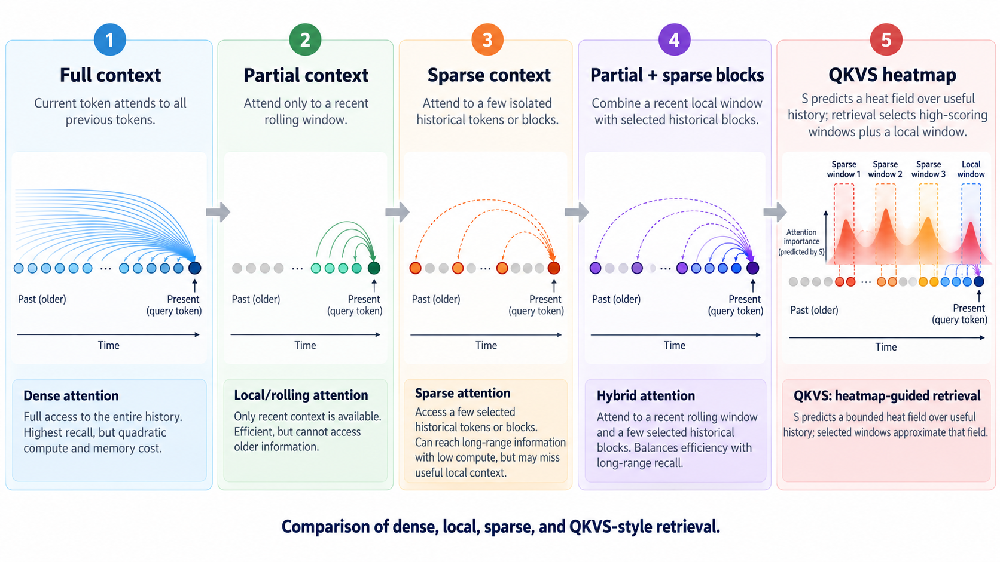
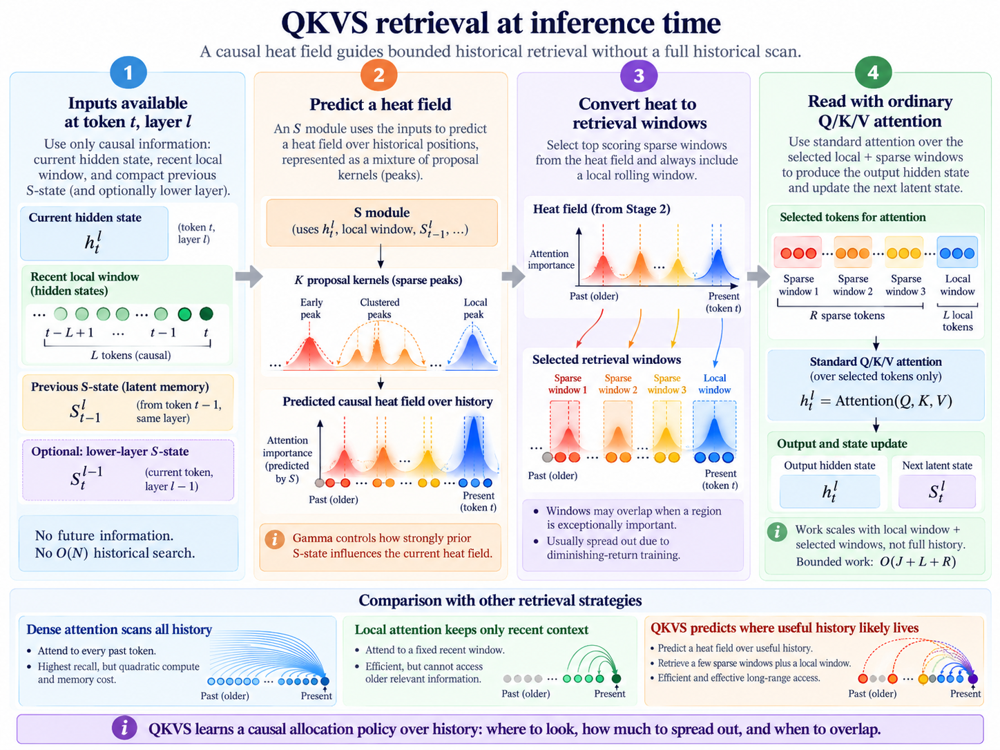
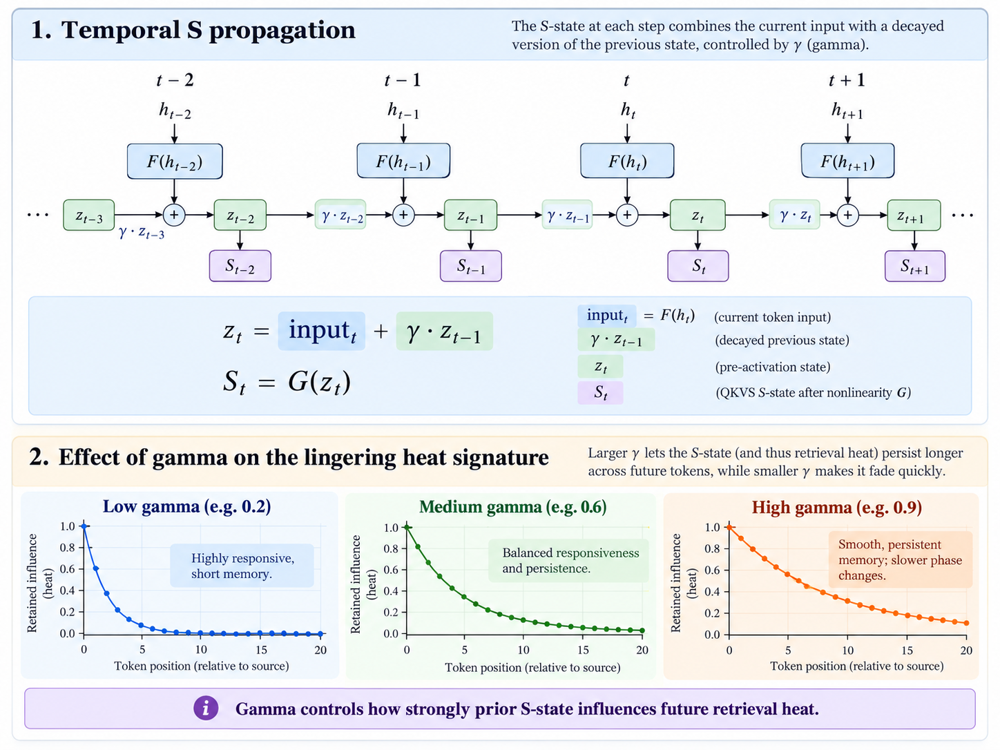

# QKVS — Causal heat-field retrieval for transformers

> **Independent research prototype — not a validated replacement for dense attention.**
> QKVS investigates whether a decoder-only autoregressive transformer can **learn where to spend a bounded historical attention budget**, guided by semantics and a compact causal memory of previous selection states, without scanning the entire historical KV cache at inference.
>
> This README is the enduring **research charter and conceptual specification**, not an experimental preregistration. See [AGENTS.md](AGENTS.md) for agent operating rules.

## The idea in one picture



**Figure 1 — Historical attention access patterns (conceptual).** The timeline runs from old tokens on the left to the current query on the right. Blue/green/orange highlighted positions indicate history accessible to attention, not a model's measured attention weights. The last panel introduces a **predicted heat field** whose peaks describe where historical information *might be useful*. QKVS converts a bounded number of those predictions into actual KV windows and always retains the local rolling window. **It does not build or scan the depicted full-width heatmap at inference.**

| Strategy                 | What the current token can read                            | Main limitation or distinction                                                                                            |
| ------------------------ | ---------------------------------------------------------- | ------------------------------------------------------------------------------------------------------------------------- |
| **Full context / dense** | Every preceding KV token                                   | Per-query attention work grows with history; more access does not guarantee better predictions.                           |
| **Partial / rolling**    | A fixed recent window of `L` tokens                        | Older evidence becomes unreachable through direct attention, though representations can sometimes relay it across layers. |
| **Sparse context**       | Selected isolated historical tokens or windows             | Historical coverage without a guaranteed local working-memory region.                                                     |
| **Partial + sparse**     | Rolling `L` plus `R` selected historical token occurrences | A *connectivity pattern*; it does not specify how to learn the selection.                                                 |
| **QKVS**                 | Rolling `L` plus bounded windows proposed by `S`           | Research proposal: learn the **semantics, spatial layout, and temporal evolution** of useful retrieval.                   |

The distinction is not “QKVS can read distant tokens while other sparse schemes cannot.” The distinction we want to establish is that **a small learned state can predict a valuable pattern of historical reads** without a context-length-dependent search. The early motivation drew on *multiscale/Kawase-style sampling*: several overlapping, differently positioned samples can collectively cover a meaningful field without inspecting every possible location.

## Target architecture: Q, K, V, and S

Ordinary attention still uses **Q/K/V**. QKVS adds **S**, a separately learned selection path. At autoregressive position `t` and transformer layer `ℓ`:

- **`h_t^ℓ`** is the causally available incoming hidden state.
- **`S_t^ℓ`** describes where to retrieve historical KV windows; it is **not** a replacement for Q/K/V.
- **`L`** is the mandatory local rolling token window.
- **`J`** is the maximum number of sparse historical proposals, with optional inactive proposals.
- **`R`** is the total historical **token-occurrence** budget actually read by those proposals. Repeated/overlapping windows count against the budget.
- **`N`** is total history length. Historical K/V storage remains `O(N)`; direct historical selection must not require an `O(N)` scan.



**Figure 2 — Proposed causal inference path.** The model computes a compact selection policy from available state, converts its proposals **directly** into a bounded number of historical addresses, then reads selected KV entries with ordinary attention. A selected window at layer `ℓ` may influence the hidden representation seen by layer `ℓ+1`, allowing **cross-layer refinement**. A compact prior state may also inform selection at the **next token**, allowing **temporal propagation**. Neither requires an earlier token to be recomputed.

### A collective heat field, not `J` unrelated coordinates

A candidate form for `S` is `J` spatial proposals, each with a center, spread, importance, and optional activity gate:

```math
S_t^\ell = \{(\mu_j,\sigma_j,w_j,g_j)\}_{j=1}^{J}, \qquad
H_t^\ell(x) = \sum_{j=1}^{J}g_jw_j\,\kappa_{\beta}(x;\mu_j,\sigma_j).
```

`H(x)` is a **conceptual heat field over eligible historical positions**. Overlap between its component kernels can express more than a set of independent point predictions:

- A strong peak near the beginning when the query refers to an introduction.
- Several clusters when comparing different historical discussions or examples.
- Concentrated sampling around a topic transition or a recalled event.
- Broadly spaced proposals when evidence is dispersed across a long discussion.
- Locally evolving peaks as newly retrieved information changes the next layer's decision.

**`β` is a possible spatial sharpness/selectivity control:** higher sharpness may concentrate heat around peaks; lower sharpness may spread it. Exact parameterization (kernel width, temperature, or an explicit learned gate) has **not** been validated. The **local rolling window is mandatory and separate** even if a conceptual figure depicts heat near the present.

The implementation must **not** materialize `H(x)` for all `N` positions and then run a top-k scan in deployment. It must map a fixed number of proposal parameters directly to bounded addresses/windows; a dense plot is for explanation and **offline supervision only**.

A proposed **64-slot** allocation study offers substantially more room for clustered and distributed proposals than earlier eight-slot controls. This is a *capacity hypothesis*, not an experimentally proven minimum. Increasing `J` without holding `R` fixed also changes attention cost: 64 windows of 32 tokens cost 2,048 historical reads, while 64 windows of four tokens cost 256. Compare `J`, window width, and `R` separately. A positive-control directory size does not imply that the same number of *heat proposals* is sufficient.

## Temporal propagation is part of the model: γ (gamma)

A principal design goal is for `S` to carry a **lingering retrieval heat signature** forward through autoregressive time. The next token should not have to rediscover the entire relevance pattern from scratch. This is **not merely an optional implementation trick**: learning how persistent or reactive historical selection should be is part of the QKVS research question.



**Figure 3 — The gamma tradeoff (illustrative).** **Low `γ`** favors new semantic evidence and rapid changes in retrieval focus. **High `γ`** keeps prior heat peaks active, smoothing transitions but potentially retaining stale relevance. The illustration uses a simplified linear decay; the eventual S update may be learned, gated, and nonlinear.

A stable **candidate** recurrence at each layer is:

```math
\begin{aligned}
u_t^\ell &= F_\ell(h_t^\ell,\,S_t^{\ell-1}),\\
z_t^\ell &= (1-\gamma_t^\ell)\,u_t^\ell
              +\gamma_t^\ell z_{t-1}^\ell,\\
S_t^\ell &= G_\ell(z_t^\ell), \qquad 0\leq\gamma_t^\ell<1.
\end{aligned}
```

`z_t^ℓ` is a small **persistent latent heat state**; `S_t^ℓ` decodes that state into spatial retrieval proposals. The first-layer cross-layer input is omitted or initialized causally. `γ` could be fixed, learned per layer, or dynamically gated per token/proposal; those are **alternatives to test**, not existing implementation facts.

- **`γ` controls persistence in time** (reactivity vs. smoothness).
- **`β` controls concentration in historical space** (broad vs. sharp heat peaks).
- The current hidden representation and lower-layer results can **shift or refine** the field, even while temporal state persists.
- Keep only the latest bounded `z_{t-1}^ℓ` / S state per active layer. Do **not** add a historical S vector for every token to the KV cache merely to enable temporal propagation.

For a simplified constant-`γ` linear update, the influence of a past impulse decays as `γ^k` after `k` tokens. A two-tap update using only the current and previous states can still have a **long effective memory through recurrence**; “two inputs” does not mean “two tokens of memory.” If peaks are stored in relative or normalized coordinates, they must be re-anchored as `t` advances or they may drift away from their historical locations. Stable gating, coordinate consistency, and the ability to forget obsolete heat remain open tests.

This design offers **two causal directions of refinement**: *across tokens* via the previous S state, and *across layers* via newly read information. Neither may use future hidden states, reread the full question, or retroactively change earlier token attention.

## Training S: attention coverage **and** downstream utility

**Train the allocation as a whole set. Do not independently reward every proposal for landing on the same high-scoring token.** The underlying concern is that a pure task-reward objective may overfit narrow answer targets or distort model behavior, while an attention-mass objective alone may chase sinks, separators, or redundant evidence. The proposed training paradigm combines **broad teacher attention coverage** with **causally measured predictive utility**, and tests whether they agree.


**Figure 4 — Proposed training flow, not a completed experiment.** Offline teacher computations may inspect all historical tokens and produce an `O(N)` importance heatmap or a binary `0/1` coverage mask. The deployable S receives **only causally available features** and emits `J` bounded proposals; it never predicts, stores, or scans an `O(N)` array at inference.

### Signal A: teacher attention coverage

A dense teacher can produce historical attention importance `a_i ≥ 0` for token `i`, aggregated across selected heads/layers and queries. This is a **dense proxy** for where a trained model tends to allocate attention. It supplies a spatial learning signal even when individual question labels are scarce.

### Signal B: causal downstream utility

For selected historical windows `B`, evaluate the reader's answer loss with and without those windows under **the same causal timing**:

```math
U(B\mid x,y) = \mathcal L(y\mid\text{rolling},x)
                - \mathcal L(y\mid\text{rolling}+B,x).
```

`U(B) > 0` means the selected set helps; `U(B) < 0` means the set hurts. Utility is **not additive**: complementary blocks may help only together, and a duplicate can change Q/K/V softmax multiplicity. The model must learn **set-level marginal value**, not merely rank individual addresses by a scalar label.

### Explicitly discount overlapping coverage

Let `c_i(B)` be the number of selected windows covering historical token `i`. An illustrative discounted attention-coverage reward is:

```math
C_\alpha(B) = \sum_i a_i\sum_{r=0}^{c_i(B)-1}\alpha^r,
\qquad 0\leq\alpha<1.
```

The first read receives full credit, a second overlap adds only `α` times that credit, a third adds `α²`, and so on. With `α=0` the teacher rewards **unique coverage only**. A very important peak may still justify multiple overlapping windows if the discounted marginal value exceeds reading something else. The **measured downstream utility** decides whether that overlap is actually beneficial.

A differentiable **training surrogate** can use the soft coverage `q_{ji}` of proposal `j` at token `i` and approximate unique occupancy as

```math
p_i = 1-\prod_{j=1}^{J}(1-q_{ji}).
```

This is a useful approximation, not a claim that an integer KV gather transmits gradients. A teacher can generate a sparse binary mask or continuous target from discounted budgeted coverage; training may use set-level distillation, offline utility preferences, or an explicitly justified gradient estimator. **Do not assume answer-loss gradients pass through hard addresses.**

An illustrative future objective mixes normalized coverage and utility while accounting for token/window budget:

```math
\max_{B:\,\mathrm{reads}(B)\le R}
\lambda_A\,\widetilde C_\alpha(B)
+\lambda_U\,\widetilde U(B)
-\lambda_{\mathrm{cost}}\,\mathrm{cost}(B).
```

These terms have different scales; **weights, normalization, curriculum, and estimator are unvalidated design variables**. Teacher coverage should help regularize narrow optimization, but it can introduce biases of its own. The primary experimental question is whether **capturing the teacher's attention mass also recovers useful prediction quality** on held-out tasks. If attention mass and true causal utility disagree, **utility wins**. Benchmark both signals separately before endorsing any mixture.

### Critical training / inference boundary

| Offline training may do                                                                                  | Causal inference must do                                                                        |
| -------------------------------------------------------------------------------------------------------- | ----------------------------------------------------------------------------------------------- |
| Dense Q/K attention, historical scans, counterfactual block ablations, budgeted teacher set construction | Produce a bounded set of addresses from current causal hidden state and bounded recurrent state |
| O(N) importance maps and binary region targets                                                           | **No O(N) heatmap output, softmax, or historical top-k search**                                 |
| Differentiable coverage surrogates and expensive utility estimation                                      | Read at most `R` historical token occurrences plus local `L`                                    |
| Use teacher labels to grade or supervise the selector                                                    | Never expose teacher-only history, gold support positions, or future questions as S inputs      |

## Non-negotiable invariants

1. **Strict single-pass autoregression.** Token `t` and layer `ℓ` use only information available before their selection/attention operation. No second question pass, future-dependent historical writes, or changes to earlier token states. Validate causal masking and incremental KV-cache execution separately from numerical floating-point equality.
2. **Bounded selection.** For fixed model dimensions and fixed `J`, `L`, and `R`, incremental historical selection and attention work must not grow with total context `N`. Intended per-token work is `O(J + L + R)` (plus fixed-size latent computation); historical KV storage is still `O(N)`.
3. **Independent selection pathway.** S's parameters are distinct from Q/K/V. Q/K/V read **real historical KV entries** after selection. Selector annotations, full-context teacher state, directory values, and answer labels must not bypass the selected attention path into decoder logits.
4. **Causal state evolution.** Cross-token state is updated from current/past representations only; cross-layer refinement follows the model's forward order. Recurrent selector state remains bounded independently of context length.
5. **Identifiability.** No model can infer an arbitrary randomized semantic-to-position mapping from a causal query state that does not contain such information. A learned spatial prior can succeed on *predictable structure*; exact arbitrary bindings require causally preserved organization or an allowed bounded index. Test these separately.
6. **Comparable research controls.** Hold task, frozen reader, token budget, causal schedule, answer scoring, source revision, and training/evaluation split constant wherever comparisons require them. Numerical backend changes can affect measured utility and must be reported.

## Research harness

QKVS uses one configuration-driven runtime. Selection policies emit bounded spatial proposals;
the reader resolves them directly to historical windows, gathers the corresponding entries from
its real K/V cache, and records every token occurrence actually read. Rolling-only and alternative
policies use the same causal execution and scoring path.

The checked-in executable configuration is a deterministic CPU verification using a small frozen
synthetic transformer. The same reader interface also supports frozen Hugging Face
`Qwen2ForCausalLM` full-attention checkpoints, including grouped-query attention and the
checkpoint's positional and normalization modules. A pretrained run additionally requires a
pinned model and tokenizer revision, an explicit execution dtype, a SHA-256-pinned UTF-8 source,
and fixed token boundaries. The checked-in long-context study is approved for one exploratory,
human-initiated GPU pilot; this authorization does not extend to follow-up runs or protocol changes.

The Qwen2 adapter writes each layer's position-rotated K/V once, then gathers only the actual
historical occurrences and mandatory rolling window used by that layer's ordinary Q/K/V
attention. Its full-history mode is an explicitly unbounded, short-sequence diagnostic for
comparison with standard Hugging Face execution; it is not a deployable selection policy.
Architectures other than Qwen2, Qwen2 checkpoints with sliding-attention layers, and Qwen2
checkpoints with nondefault RoPE scaling are currently unsupported.

### Dense bootstrap and QKVS activation

Execution has three explicit phases, controlled by working-memory width `W` and activation
threshold `T` (`W=4096`, `T=6144` in the initial long-context configuration):

1. Positions `0..W-1` use ordinary full causal Q/K/V attention. S is neither invoked nor advanced.
2. Positions `W..T-1` remain full causal Q/K/V attention. This dense bridge creates history that
   becomes eligible after the working window starts sliding; eligibility is not a retrieved read.
3. At position `T`, S starts from a zero recurrent state. The newest `W` cache positions, including
   the current position's newly written K/V, are mandatory working memory. Only older positions are
   eligible for at most `R` S-directed historical occurrences. `J`, spatial resolution, and `R`
   remain independent.

The zero state participates in the same recurrence as every later state: the first update is
`z_T = gamma * 0 + (1 - gamma) * u_T`. It is not a special case that bypasses gamma.

Training and evaluation use this same boundary and absolute position accounting. The dense prefix
is independent of S, so Qwen2 can persist an immutable prefill snapshot containing its per-layer
rotated K/V, dense-score metadata, final boundary logits, and next absolute position. Snapshots are
keyed and validated by exact prefix tokens, frozen model identity and weight digest, RoPE/position
configuration, numerical settings, `W`, `T`, and train/evaluation ownership. Identical trajectories
within one owner can share a snapshot; restoration copies cache containers before appending, and no
post-transition K/V or S state is persisted or shared between trajectories.

Dense prefill uses a fixed-capacity Hugging Face cache in bounded query chunks, then stores one
contiguous K/V tensor per layer. Post-transition Qwen2 caches are preallocated and selected with
direct tensor gathers, avoiding per-token full-cache stacking and repeated cache concatenation.
Continuation losses and predictions transfer to the host in one batch rather than synchronizing
once per scalar token result; learned proposal parameters use one bounded transfer per layer update.
Access artifacts encode exact rolling ranges and selected windows with compact varints rather than
expanding thousands of contiguous token indices into JSON. Proposal parameters used for temporal
heat-field plots are sampled at a configured interval (64 tokens in the long study); access counts,
overlap, and exact executed windows remain recorded at every continuation token and layer.

The first learned-S implementation uses an independent per-layer MLP over the causal hidden state
and the bounded current lower-layer proposal state. It emits center, spread, importance, and gate
for each of `J` proposals. Recurrent state stores absolute token centers so fixed gamma persistence
does not drift as the eligible context grows. Effective hard window width is the configured spatial
resolution multiplied by learned spread and divided by fixed beta; every resulting occurrence,
including overlap, consumes `R`. Inactive gates produce no hard read.

Training keeps Q/K/V frozen. A dense offline teacher supplies historical attention coverage, using
the differentiable collective occupancy `1 - product(1 - q)` with alpha zero so redundant soft
overlap earns no additional coverage. A dense causal soft-occupancy attention pass supplies the
next-token utility gradient; actual hard-window utility is measured separately because integer
gathers do not transmit address gradients. Fixed gamma and beta are the deliberately narrow first
implementation. Learned or dynamic gamma/beta remain unsupported alternatives, not silently
ignored settings.

After dense activation, training advances each stream once through coherent causal rollout
segments. K/V and recurrent S continue across target positions and optimizer updates; selector
weights stay fixed within a segment and change only at its boundary. Target positions are
stratified across each segment and rotate through layers. Prior hard decisions and recurrent states
remain detached, so gradients apply only to selected target token/layers rather than providing full
temporal credit assignment. Atomic checkpoints include the exact post-transition training K/V, S
state, position, optimizer, and policy, and may resume only the same identified trajectory.

`full_qkv` is an explicit reference continuation: it restores the same dense prefill at `T`, then
reads the complete causal cache on the same ground-truth stream. It is deliberately unbounded and
is never reported as an `R`-matched control. Its next-token loss is a reference measurement, not a
logit target or presumed quality ceiling.

```text
configuration
    -> shared harness lifecycle
        -> selection policy -> bounded proposal resolution
        -> frozen reader -> actual rolling + historical K/V gathers
        -> shared per-token and retrieval metrics
    -> atomic run artifact
```

The public command surface is:

```bash
qkvs --help
qkvs validate --config configs/harness_smoke.json
qkvs run --config configs/harness_smoke.json --device cpu
qkvs status --run artifacts/results/harness-smoke
qkvs summarize --run artifacts/results/harness-smoke
```

`uv` is the bootstrap package manager: it creates an isolated user-level environment and installs
the `qkvs` command with its Python dependencies. It is not part of experiment execution. QKVS does
not use a repository `.venv` or modify the operating system's Python packages. The pinned stack
supports Python 3.14, which `uv` uses to bootstrap the installed command:

```bash
./bootstrap.sh
```

Bootstrap installs the current checkout as an editable tool with its runtime dependencies. Run it
again only when the package metadata or dependencies change. It does not validate or execute an
experiment.

Execution is independent of `uv`. `run.sh` accepts a configuration, validates it, selects its sole
declared `execution.allowed_devices` entry, checks driver health for CUDA, and invokes the installed
CLI:

```bash
./run.sh configs/harness_smoke.json
./run.sh configs/heatfield_learning_study.json
```

Configurations intended for `run.sh` must authorize exactly one device. Use the public `qkvs run`
command directly when choosing among multiple authorized devices.

`uv` installs commands in its user tool bin directory. `run.sh` uses `qkvs` from `PATH` or its
default user-tool location. To use `qkvs` directly from any shell, run `uv tool update-shell` once
and start a new shell if `uv tool install` reports that its bin directory is not already on `PATH`.

The human-started interface for the long-context held-out learning study is:

```bash
./run.sh configs/heatfield_learning_study.json
```

The study configuration is `approved` for one human-initiated exploratory learning/feasibility
pilot. It is not a conclusive convergence or generalization test. It uses independent 16,384-token
training and held-out spans from a SHA-256-pinned Project Gutenberg source, with `W=4096`, `T=6144`,
`J=64`, spatial resolution 8, and `R=512`. A missing local source is fetched atomically from its
pinned HTTPS origin and rejected unless byte count and digest match. Conditions are rolling-only,
fixed offsets, identically initialized untrained S, trained S, and full QKV. Stop on nonfinite
losses, identity mismatches, or resource exhaustion; preserve resumable artifacts rather than
changing the frozen protocol. `heatfield_initial.json` remains an incomplete earlier design draft.
Codex must not run CUDA workloads. Configuration validation, status, and summarization do not
import the model runtime or initialize CUDA.

## Configuration and artifacts

Configurations keep proposal count, window width, and historical token-occurrence budget separate.
They declare the rolling baseline, matched alternative policies, gamma and beta controls, scoring,
data identity, nonoverlapping train/evaluation token boundaries, device authorization, and run ID.
Unsupported combinations fail validation.

Each run writes `artifacts/results/<run-id>/result.json`. The artifact contains source and config
hashes, raw per-token losses, compact exact K/V access ranges, overlap and coverage measurements,
paired utility, deterministic bootstrap uncertainty where at least two independent streams exist,
progress, and completion state. A one-stream comparison retains its raw paired loss but is labeled
descriptive and has no bootstrap confidence interval. Common-prefix and post-transition quality are
summarized separately, including early/middle/late continuation loss. Wall time covers snapshot
restoration plus continuation; accelerator peak memory is recorded when available. These are
implementation measurements, not theoretical speedup claims. Writes are atomic; rerunning the same
command resumes without duplicating completed condition/stream pairs.

Progress covers dense prefills, durable training-checkpoint ranges, and evaluation conditions. In an
interactive terminal, a short ASCII spinner and elapsed timer update once per second on one physical
row; the 24-cell `█▓▒` bar uses third-cell shading, and the line is clipped to the detected terminal
width and erased before every redraw. Redirected output receives one line per work unit instead of
heartbeat writes. Completed counts advance only after the corresponding artifact is written
atomically. `qkvs status` reports the same phase breakdown for an interrupted or concurrent run.

`configs/heatfield_learning_study.json` is the sole approved exploratory learning pilot. Passing
CPU smoke tests, completing this pilot, or observing a favorable region does not establish that
learned S converges, generalizes, or improves hard next-token prediction.
